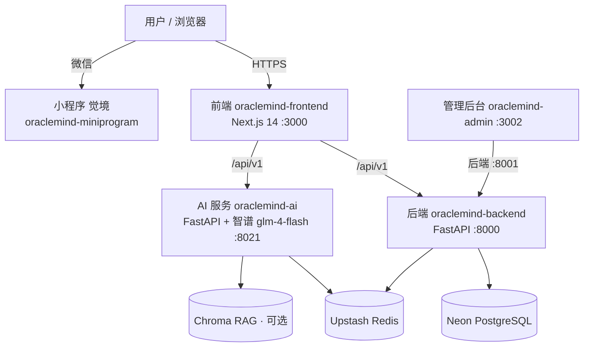

# 玄镜 OracleMind · 主仓库（总览 / Meta Repo）

> 东方玄学 × 现代技术 —— 七术数在线测算与心理成长平台

本仓库是 **总览型主仓库（meta repo）**：它**不存放服务源码**，只承载产品文档、架构说明、子仓导航与协作约定。各服务的源码与独立部署分别落在各自的 GitHub 仓库与 Vercel 项目中。

> ⚠️ **在本仓库提交代码不会触发任何线上部署。** 改哪个服务就去哪个子仓库提交（见下方「子仓导航」）。本仓库只收文档与协作规范的改动。

---

## ✨ 产品定位

- **左轨 · 玄镜（CN）**：卜卦、周公解梦、风水、塔罗、星座、数字密码、疗愈——传统文化娱乐向。已完成合规整改（吉凶结论→「觉察」话术、AI 输出外链硬清洗、PIPL 同意流、支付去对价化）。
- **右轨 · Xuanjing（出海）**：心理学 / 文化成长产品，Stripe 支付，香港主体，英文名 Xuanjing；微信小程序品牌名「**觉境**」。

## 🏗 架构拓扑

- **前端**：Next.js 14（App Router）+ React 18 + TypeScript + Sass 自建组件库（暗色紫青主题）。
- **后端**：FastAPI 排盘计算服务（八字 / 紫微 / 六爻 / 梅花 / 奇门 / 数字命理），确定性计算；PostgreSQL + Redis。
- **AI 服务**：LangGraph 多智能体 + RAG + SSE 流式解读，模型智谱 `glm-4-flash`；LLM 失败自动降级本地规则。
- 接入原则：前端优先调后端 API，失败静默降级本地算法，保证离线可用。

## 📦 子仓导航

| 服务 | 本地目录 | GitHub 仓库 | Vercel 项目 | 端口 / 生产域名 | 状态 |
|------|----------|-------------|-------------|------------------|------|
| 前端 | `oraclemind-frontend/` | `wufan0312/oraclemind-frontend` | `oraclemind-frontend` | `:3000` · `oraclemind-frontend.vercel.app` | ✅ 已部署 |
| 后端 | `oraclemind-backend/` | `wufan0312/oraclemind-backend` | `oraclemind-backend` | `:8000` · `oraclemind-backend.vercel.app` | ✅ 已部署 |
| AI 服务 | `oraclemind-ai/` | `wufan0312/oraclemind-ai` | `oraclemind-ai-eight` | `:8021` · `oraclemind-ai-eight.vercel.app` | ✅ 已部署 |
| 管理后台 | `oraclemind-admin/` | （未建远程仓） | （未部署） | `:3002` · 后端 `:8001` | ⚠️ 未纳管 |
| 微信小程序 | `oraclemind-miniprogram/` | （未建远程仓） | （未部署） | 品牌「觉境」 | ⚠️ 未纳管 |

> 历史文档里 AI 目录曾写作 `oraclemind-ai-py`，当前磁盘目录名已统一为 `oraclemind-ai`（与远程仓同名）。

## 📚 文档索引

| 文档 | 内容 |
|------|------|
| `docs/architecture.md` | 架构、技术栈、数据流、部署拓扑与目录职责详述 |
| `docs/deployment.md` | Vercel + 环境变量部署规范（精炼版） |
| `docs/compliance.md` | 合规整改记录（三要件模型、已落地项、措辞规范） |
| `docs/roadmap.md` | 出海 / 双轨战略路线图与待办 |
| `docs/ai-troubleshooting.md` | AI 服务缓存 / 重启 / 外链清洗排查手册 |
| `VERCEL_DEPLOY.md` | Vercel CLI 直连部署总手册（详细，含 6.x 排错） |
| `ENV_SETUP.md` | 三端环境变量配置规范与静默坑 |

## 🤝 协作约定

- **分支**：三主仓均停在 `main`；出海分支 前端 / AI `compliance-i18n-b1`、后端 `compliance-geo`。
- **提交归属**：改哪个服务就在哪个子仓提交并 `push`，Vercel Git 集成自动部署。本主仓只收文档改动。
- **env 铁律**：真实密钥只在 Vercel 面板与本地 `.env`；`.env.production` / `.env.development`（非敏感默认）可随仓库提交；改面板变量后必须 **Redeploy**（前端 `NEXT_PUBLIC_*` 构建期内联，改了不重部署线上仍是旧值）。
- **推送**：remote 统一 SSH（`git@github.com:wufan0312/...`）；`github.com` 受限时走代理或 Vercel CLI 直连部署。

## ⚠️ 部署链路三个「静默坑」

1. **面板空串变量盖掉 `.env.production`**：面板建了变量却留空，比不建更危险——构建期内联出 `""`。判据：找一个只在文件里定义、面板绝不配的变量（如 `NEXT_PUBLIC_ICONFONT_CDN`）去产物里查是否生效。
2. **`.vercelignore` 的 `.env.*` 误排分层配置**：会连 `.env.production` 一起排除。正确写法是用精确列举（`.env` / `.env.local` / `.env.*.local`），保留 `.env.production`。
3. **改面板变量不触发部署**：Vercel 只对 push commit 自动部署，改面板必须手动 Redeploy。

> 🚫 **域名撞车**：`https://oraclemind.vercel.app` **不是我们的项目**（同名英文站）。配 `CORS_ORIGINS` / `NEXT_PUBLIC_*` 前先 `curl -s <域名> | grep "<title>"` 确认归属。

## 📄 免责声明

本平台内容仅供传统文化研究与娱乐参考，不构成任何医疗、法律、投资建议，请理性看待。出海产品（Xuanjing / 觉境）定位于心理学与文化成长，遵守对应区域合规要求。
