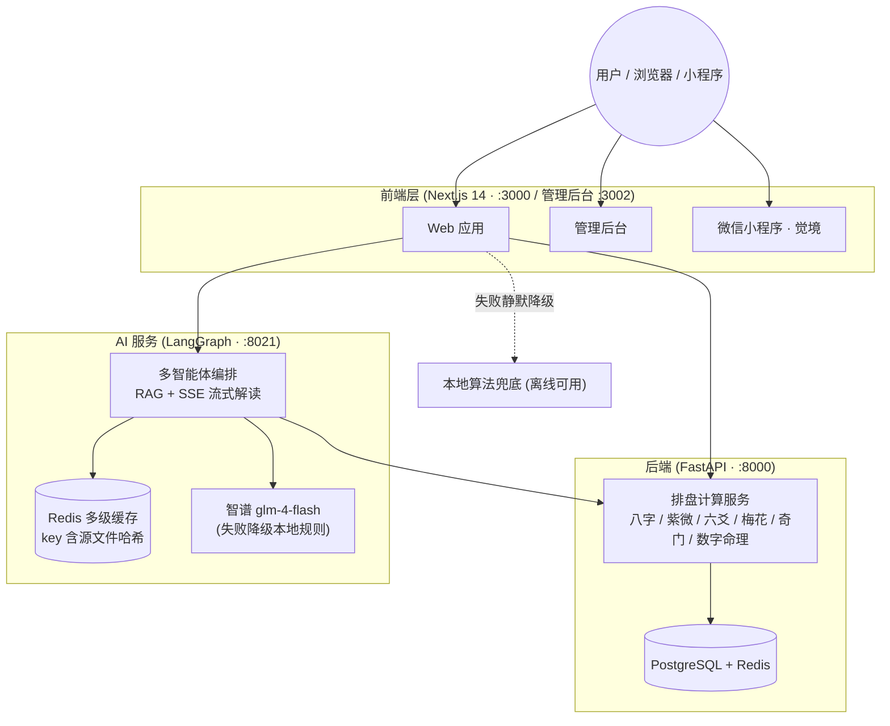

# 玄镜 OracleMind

一套已上线的生产级 AI 应用平台，独立从 0 到 1 交付并持续迭代。前端、后端、AI 服务三端解耦，覆盖 Web、小程序、管理后台。

核心价值不在“会调模型”，而在**把不稳定的 LLM 输出做成稳定产品能力**——多层清洗与契约归一化、成本缓存治理、三层降级链、crosscheck 测试。坚持 AI 与算法分离，确定性计算不交给模型。

> 本仓库是项目总览（meta repo），承载架构说明、子仓导航与协作约定。各服务的源码与独立部署在对应子仓库。

## 项目架构

三端解耦，各司其职：

- **前端**：Next.js 14（App Router）+ React 18 + TypeScript + Sass 自建组件库（暗色紫青主题）。
- **后端**：FastAPI 排盘计算服务（八字 / 紫微 / 六爻 / 梅花 / 奇门 / 数字命理），确定性计算；PostgreSQL + Redis。
- **AI 服务**：LangGraph 多智能体 + RAG + SSE 流式解读；LLM 失败自动降级本地规则。
- **接入原则**：前端优先调后端 API，失败静默降级本地算法，保证离线可用。

## 核心能力

**输出稳定性**
  
多层防御（清洗、截断修复、契约归一化、前端兜底）+ 三层降级链 + crosscheck 测试。LLM 输出异常时，系统有明确的兜底路径，而不是把崩溃直接抛给用户。

**成本治理**
  
预算熔断 + Redis 多级缓存（key 含源文件哈希，改动自动失效）+ 令牌桶与分布式限流。模型调用成本可控。

**多智能体协作**
  
LangGraph 编排与工具调用，带防死循环机制。Prompt 版本治理，SSE 全链路流式。

**合规与安全**
  
已完成合规整改（吉凶结论→「觉察」话术、AI 输出外链硬清洗、PIPL 同意流、支付去对价化）。JWT 鉴权、数据加密、审计日志。

**前端工程化**
  
Vue3 / TypeScript 大屏可视化、Three.js 3D、uni-app 跨端（复用率超 85%）。主导过大型重构，打包体积 -30%，首屏 +40%。

## 关键设计决策

**1. 为什么 AI 与算法分离？**
  
确定性计算不交给模型。排盘计算由后端 FastAPI 完成，模型只负责“生成候选解读”，系统代码负责“校验和兜底”。这是整个平台输出稳定性的基础。

**2. 三层降级链分别降什么？**
  
当 LLM 输出异常或超时时，系统按预设路径逐层降级。具体触发条件和降级策略见 AI 服务层仓库的 README。

**3. 成本缓存怎么设计的？**
  
Redis 缓存 key 包含源文件哈希，内容改动后缓存自动失效，避免“改了代码还在用旧结果”的问题。

**4. RAG 检索阈值怎么定的？**
  
Chroma RAG + Embedding，做过语料入库与检索评测。阈值调高调低的对比结果记录在 AI 服务层仓库。

## 子仓导航

| 服务    | GitHub 仓库                       | 端口 / 生产域名                                  | 状态     |
| :---- | :------------------------------ | :----------------------------------------- | :----- |
| 前端    | `wufan0312/oraclemind-frontend` | `:3000` · `oraclemind-frontend.vercel.app` | ✅ 已部署  |
| 后端    | `wufan0312/oraclemind-backend`  | `:8000` · `oraclemind-backend.vercel.app`  | ✅ 已部署  |
| AI 服务 | `wufan0312/oraclemind-ai`       | `:8021` · `oraclemind-ai-eight.vercel.app` | ✅ 已部署  |
| 管理后台  | （未建远程仓）                         | `:3002` · 后端 `:8001`                       | ⚠️ 未纳管 |
| 微信小程序 | （未建远程仓）                         | 品牌「觉境」                                     | ⚠️ 未纳管 |

## 技术栈

**前端**：Next.js / React 18 / TypeScript / Sass / Vue3 / Three.js / uni-app
  
**后端**：FastAPI / 异步 PostgreSQL / Redis / Docker Compose
  
**AI 服务**：Python / LangGraph / ChromaDB / SSE / 智谱 glm-4-flash
  
**安全与质量**：JWT / 数据加密 / 审计日志 / crosscheck 测试

## 文档索引

| 文档                           | 内容                      |
| :--------------------------- | :---------------------- |
| `docs/architecture.md`       | 架构、技术栈、数据流、部署拓扑与目录职责详述  |
| `docs/deployment.md`         | Vercel + 环境变量部署规范       |
| `docs/compliance.md`         | 合规整改记录                  |
| `docs/roadmap.md`            | 出海 / 双轨战略路线图            |
| `docs/ai-troubleshooting.md` | AI 服务缓存 / 重启 / 外链清洗排查手册 |

## 协作约定（运维备忘）

- **分支**：三主仓均停在 `main`；出海分支 前端 / AI `compliance-i18n-b1`、后端 `compliance-geo`。
- **提交归属**：改哪个服务就在哪个子仓提交并 `push`，Vercel Git 集成自动部署。本主仓只收文档改动。
- **env 铁律**：真实密钥只在 Vercel 面板与本地 `.env`；`.env.production` / `.env.development` 可随仓库提交；改面板变量后必须 Redeploy。
- **推送**：remote 统一 SSH；`github.com` 受限时走代理或 Vercel CLI 直连部署。

## 部署链路三个「静默坑」

1. **面板空串变量盖掉 .env.production**：面板建了变量却留空，比不建更危险——构建期内联出 `""`。
2. **.vercelignore 的 .env.* 误排分层配置**：会连 `.env.production` 一起排除。正确写法是用精确列举。
3. **改面板变量不触发部署**：Vercel 只对 push commit 自动部署，改面板必须手动 Redeploy。

> 🚫 **域名撞车**：`https://oraclemind.vercel.app` 不是我们的项目。配 `CORS_ORIGINS` / `NEXT_PUBLIC_*` 前先 `curl -s <域名> | grep "<title>"` 确认归属。

## 免责声明

本平台内容仅供传统文化研究与娱乐参考，不构成任何医疗、法律、投资建议，请理性看待。出海产品（Xuanjing / 觉境）定位于心理学与文化成长，遵守对应区域合规要求。
